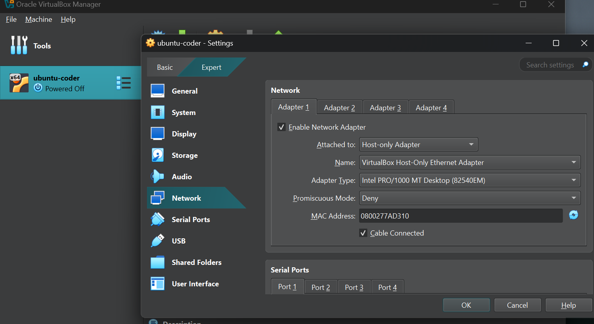
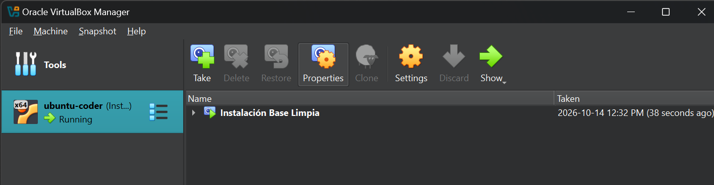

# Laboratorio seguro con VirtualBox

**Estudiante:** Juan Skobalski  
**Curso:** Ciberseguridad  
**Máquina virtual:** `ubuntu-coder`

## Objetivo

Configurar un entorno virtualizado para realizar prácticas de ciberseguridad con un nivel inicial de aislamiento respecto de la red doméstica. La máquina virtual funciona como sistema invitado (*guest*) dentro del equipo físico (*host*) y puede volver a un estado conocido mediante una instantánea.

## Configuración de red

La VM utiliza el modo **Adaptador Solo-Anfitrión (Host-Only Adapter)** mediante `VirtualBox Host-Only Ethernet Adapter`. El modo promiscuo se encuentra configurado como **Denegar**.

### Justificación técnica

Elegí **Solo-Anfitrión** porque crea una red privada entre el host y la máquina virtual sin conectar directamente la VM a Internet ni incorporarla como otro equipo de la red doméstica. Esto permite administrar el laboratorio o intercambiar información controlada con el host, mientras se reduce la exposición frente a otros dispositivos de la red.

No utilicé **Adaptador Puente (Bridged)** porque ese modo conecta la VM a la misma red física que el host y le asigna presencia propia dentro de la red local. Una configuración insegura o un servicio vulnerable en la VM podría quedar accesible para otros dispositivos, ampliar la superficie de ataque y permitir que una práctica afecte el entorno doméstico.

Solo-Anfitrión conserva un canal entre el host y el guest, por lo que no representa aislamiento absoluto. Para ejecutar archivos maliciosos o hacer pruebas de mayor riesgo, corresponde utilizar **Red Interna** o **No conectado**, además de desactivar carpetas y portapapeles compartidos.

## Protección del estado inicial

Se creó la instantánea **Instalación Base Limpia** como punto de recuperación de la VM. Esta instantánea permite volver al estado base si una configuración, herramienta o práctica posterior provoca errores o compromete el sistema invitado.

## Controles aplicados

| Control | Configuración documentada | Finalidad |
| --- | --- | --- |
| Red virtual | Solo-Anfitrión | Evitar la exposición directa a Internet y a la red doméstica. |
| Modo promiscuo | Denegar | Impedir que la interfaz capture tráfico no destinado a la VM. |
| Instantánea | Instalación Base Limpia | Recuperar un estado conocido antes de realizar nuevas prácticas. |

## Conclusión

La configuración elegida ofrece un laboratorio inicial con conectividad limitada y capacidad de recuperación. El aislamiento debe ajustarse al riesgo de cada práctica: cuanto más peligroso sea el software o la prueba, menor conectividad y menos integraciones con el host deberían habilitarse.
