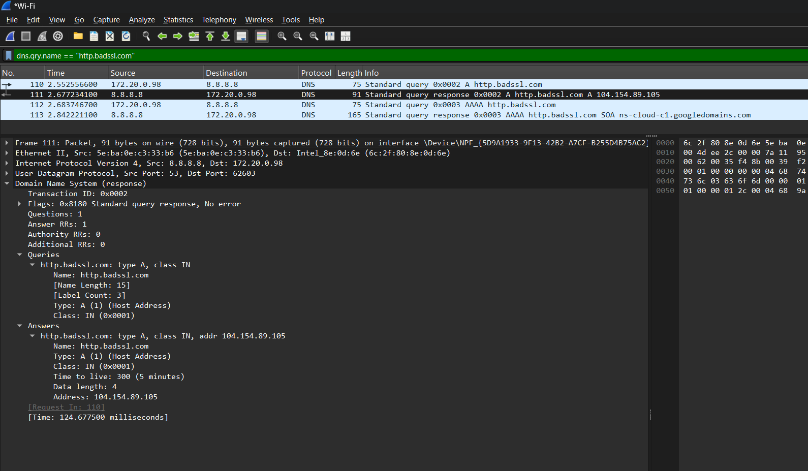
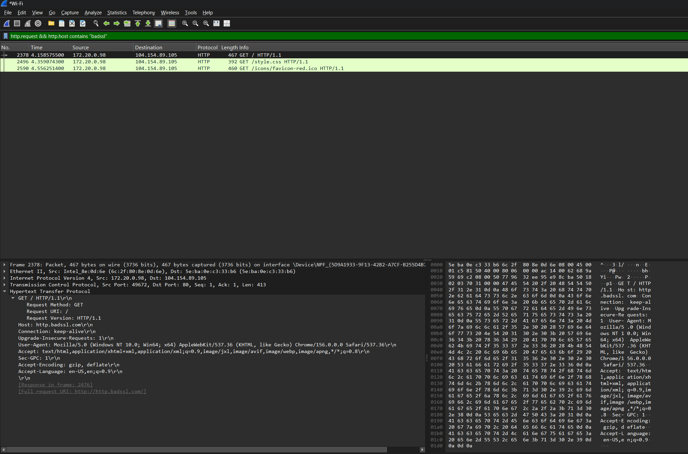
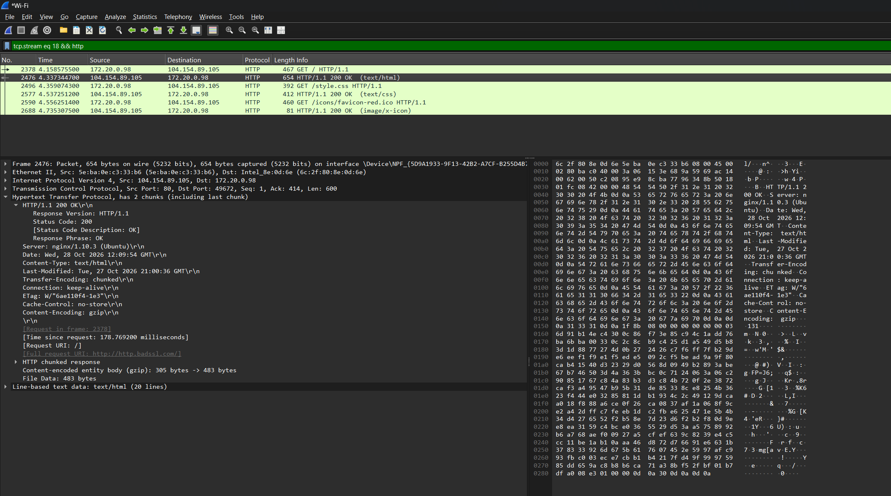
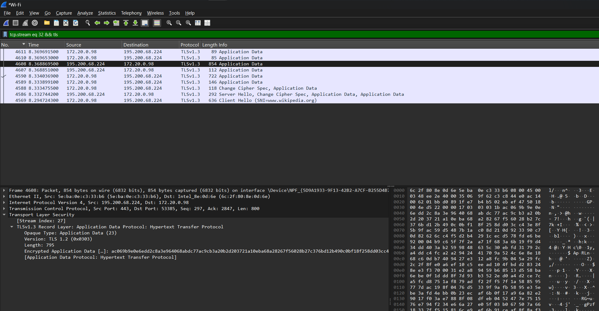
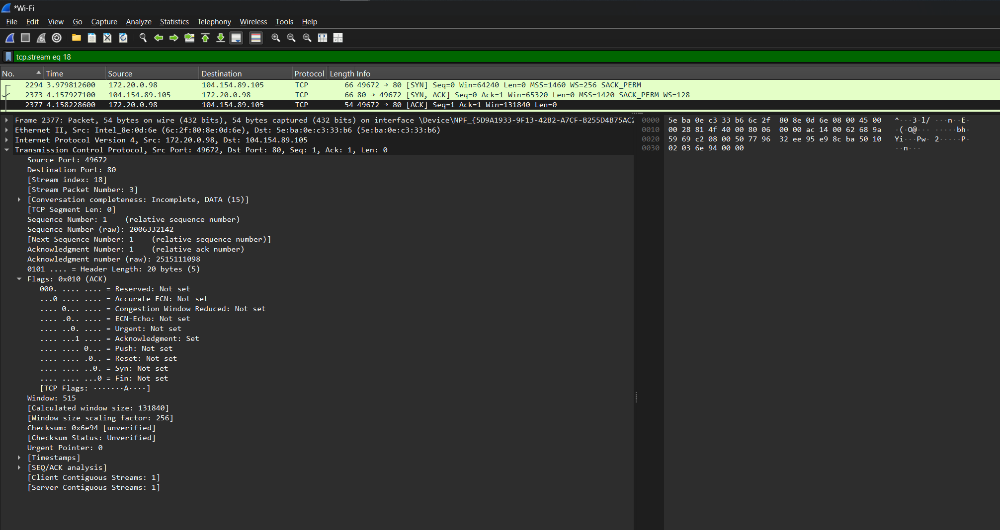
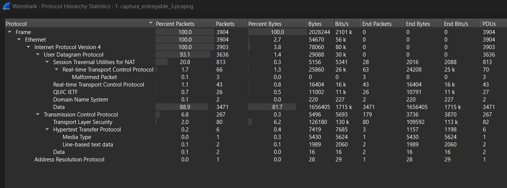

# Reporte de Análisis de Tráfico

**Estudiante:** Juan Skobalski  
**Curso:** Ciberseguridad  
**Entrega:** Pre entrega 3  

## Introducción

Este reporte documenta una captura controlada del tráfico generado desde la computadora del estudiante. El análisis busca identificar los protocolos involucrados en una navegación web, comparar una comunicación HTTP sin cifrado con una comunicación HTTPS protegida por TLS y reconocer el establecimiento de una conexión TCP mediante el three-way handshake.

La práctica se limita al tráfico propio y utiliza sitios públicos de prueba, sin enviar credenciales ni información sensible.

## Metodología y alcance

La captura se realizó con Wireshark sobre la interfaz Wi-Fi. Durante la sesión se visitó `http://http.badssl.com/` para producir tráfico HTTP y `https://www.wikipedia.org/` para producir tráfico HTTPS. NeverSSL fue reemplazado porque no cargó correctamente en la conexión utilizada.

## Inventario de protocolos

| Protocolo | Función observada | Evaluación de seguridad |
| --- | --- | --- |
| DNS | Resolución de nombres de dominio a direcciones IP | El DNS tradicional no cifra las consultas y puede exponer los dominios consultados |
| TCP | Transporte confiable y establecimiento de conexiones | No cifra por sí mismo; la protección depende del protocolo de aplicación |
| HTTP | Solicitud y respuesta de contenido web | Inseguro: transmite encabezados y contenido en texto claro |
| TLS | Protección criptográfica del tráfico HTTPS | Seguro frente a la lectura directa del contenido durante el tránsito, si está correctamente configurado |

## Análisis DNS

Se consultó el registro A de `http.badssl.com` contra el servidor DNS `8.8.8.8`. La respuesta devolvió la dirección IPv4 `104.154.89.105`, coincidente con el servidor observado en la conexión HTTP. La consulta se generó mediante `nslookup` para evitar que la caché o la resolución cifrada de Brave ocultaran el intercambio DNS tradicional.

## Tráfico HTTP

La solicitud HTTP permite leer directamente el método, el host y la URI. En la captura se observó una solicitud `GET / HTTP/1.1` dirigida a `http.badssl.com` y la respuesta `HTTP/1.1 200 OK` enviada por `104.154.89.105`.

## Tráfico HTTPS y TLS

En HTTPS, HTTP viaja dentro de una sesión TLS. Wireshark identifica registros de tipo **Application Data**, pero la carga útil aparece cifrada y no permite leer directamente el contenido de la página, a diferencia de la solicitud HTTP.

## Three-Way Handshake de TCP

El establecimiento de la conexión TCP consta de tres mensajes:

1. **SYN:** el cliente solicita iniciar una conexión y propone sus parámetros iniciales.
2. **SYN-ACK:** el servidor acepta la solicitud y confirma la recepción del SYN.
3. **ACK:** el cliente confirma la respuesta del servidor y deja establecida la conexión.

## Análisis de seguridad

HTTP es inseguro porque no aporta confidencialidad, autenticación criptográfica ni protección de integridad. Un observador con acceso al tráfico puede leer elementos como el método, el host, la URI, los encabezados y cualquier dato de aplicación transmitido sin protección.

HTTPS añade TLS para cifrar el contenido, comprobar su integridad y autenticar al servidor mediante certificados. Aun así, ciertos metadatos de la conexión, como las direcciones IP, el volumen y los tiempos del tráfico, pueden seguir siendo observables.

Una VPN cifra el tráfico entre el dispositivo y el servidor VPN, lo que reduce la exposición frente a observadores de la red local o de una red Wi-Fi pública. No reemplaza HTTPS: la protección de la VPN termina en su servidor y la confianza se traslada al proveedor de VPN.

## Conclusiones y recomendaciones

La captura demuestra que TCP establece primero una conexión lógica y que la seguridad del contenido depende de las capas superiores. HTTP deja información legible, mientras que TLS protege los datos de aplicación de HTTPS. Se recomienda evitar el envío de información sensible mediante HTTP, comprobar que los sitios utilicen HTTPS, mantener el navegador actualizado y utilizar una VPN confiable cuando se empleen redes públicas, sin considerarla un reemplazo del cifrado de extremo a extremo proporcionado por HTTPS.

## Evidencia del inventario

