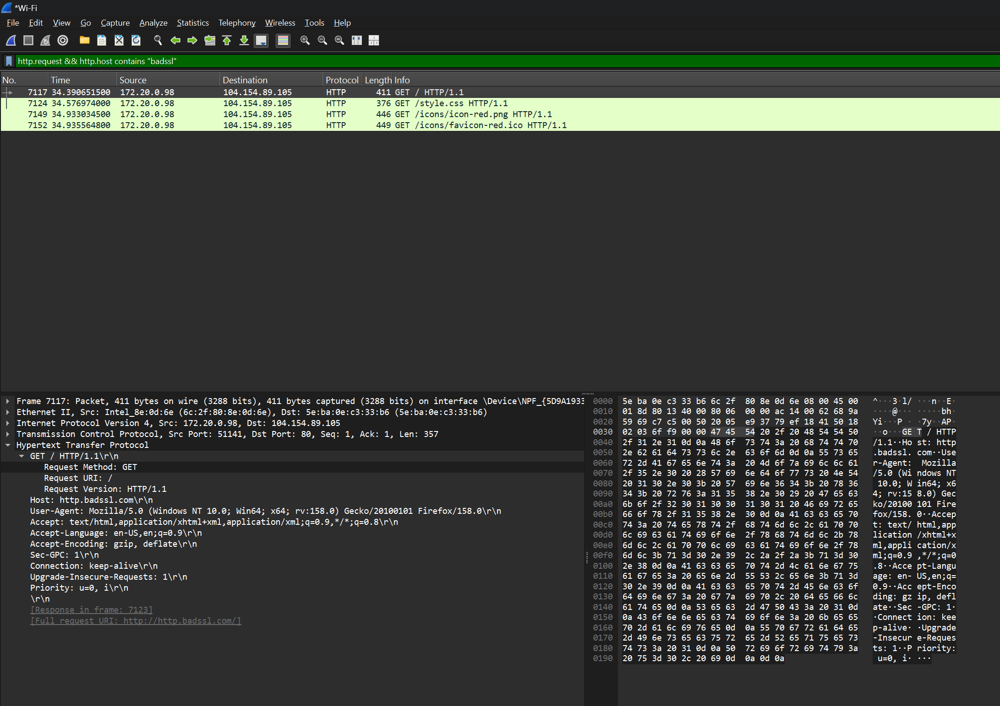
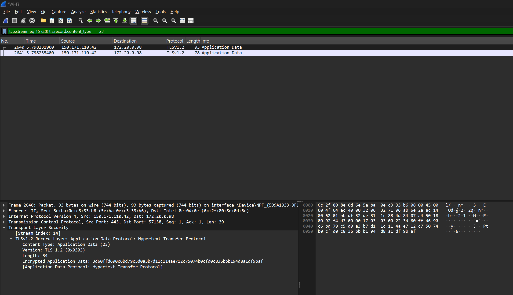
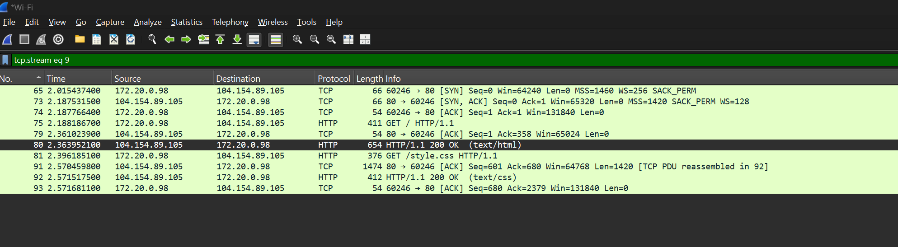

# Laboratorio de observación de tráfico con Wireshark

**Estudiante:** Juan Skobalski  
**Curso:** Ciberseguridad  
**Unidad:** 3  
**Ejercicio:** 2  

## Introducción

Este reporte documenta una observación controlada de tráfico propio con Wireshark. El objetivo es comparar la información visible en una solicitud HTTP con los datos protegidos por TLS durante una conexión HTTPS y reconocer el handshake de tres pasos utilizado por TCP.

## Alcance y entorno

La práctica se realiza sobre la interfaz de red activa del equipo y utiliza Brave para generar tráfico propio sobre sitios públicos destinados a pruebas de conectividad. No se ingresan credenciales ni información personal. Para HTTP se utiliza `http://http.badssl.com/`; para HTTPS se utiliza `https://example.com/`.

## Captura de tráfico HTTP

Se abrió BadSSL utilizando explícitamente el esquema `http://` y se filtró la captura mediante:

```text
http.request && http.host contains "badssl"
```

En el paquete GET se pueden leer el método, el recurso solicitado, el dominio y otros encabezados. Esto demuestra que HTTP transmite la información de aplicación sin cifrado.



## Captura de tráfico HTTPS

Se accedió a Example Domain mediante HTTPS y se aplicó el filtro `tls`. Los paquetes identificados como **Application Data** contienen la información de aplicación cifrada. La vista hexadecimal muestra bytes, pero no permite leer directamente el contenido de la página ni posibles datos enviados por el usuario.



## Handshake TCP

Se aisló el flujo TCP asociado a la conexión HTTP mediante el filtro `tcp.stream eq N`. Al comienzo del flujo se identificaron los mensajes SYN, SYN-ACK y ACK. Esta secuencia confirma que TCP establece la conexión entre cliente y servidor antes de intercambiar los datos de la aplicación.



## Riesgo de enviar una contraseña mediante HTTP

Si un atacante pudiera capturar los paquetes de una sesión HTTP en la que se introduce una contraseña, podría leerla directamente porque HTTP no cifra el contenido transmitido. También podría observar otros datos de la solicitud, reutilizar las credenciales para intentar acceder a la cuenta o modificar el tráfico durante su recorrido. En HTTPS, TLS cifra la información de aplicación, por lo que una captura equivalente no permite leer directamente la contraseña. Por este motivo nunca se deben enviar credenciales mediante HTTP.

## Conclusión

La práctica permite comprobar que el handshake TCP y el cifrado TLS cumplen funciones diferentes. TCP establece una comunicación confiable entre los extremos, mientras que TLS protege la confidencialidad e integridad de los datos que circulan sobre esa conexión. HTTP sin TLS deja expuesta la información de aplicación y no debe utilizarse para transmitir datos sensibles.
