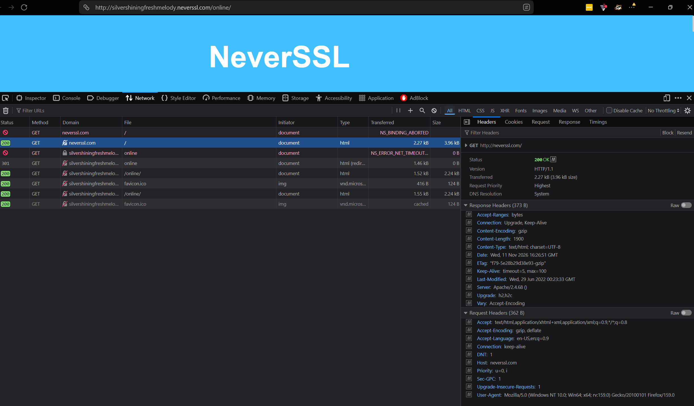

# Informe de Auditoría de Red Wi-Fi Insegura

**Autor:** Juan Skobalski  
**Curso:** Ciberseguridad · Módulo 6 · Ejercicio 2  
**Estado:** análisis y evidencia documentados; publicación pendiente.

## Introducción

Este informe analiza la exposición de información al utilizar HTTP y explica cómo HTTPS y una VPN reducen riesgos en redes públicas. La práctica se limita a solicitudes generadas desde el equipo propio mediante las herramientas de desarrollador de Zen, basado en Firefox. No requiere conectarse a una red pública ni interceptar comunicaciones de terceros.

El panel Network permite examinar las solicitudes desde el navegador. No constituye por sí solo evidencia de que un tercero haya interceptado tráfico ni demuestra un ataque real.

## Sitio analizado

La solicitud seleccionada en la captura corresponde a **`http://neverssl.com/`**, con host **`neverssl.com`**. Se utilizó Zen, basado en Firefox, en Windows.

La barra de direcciones muestra una página posterior: `http://silvershiningfreshmelody.neverssl.com/online/`. La lista registra solicitudes adicionales a ese subdominio, incluida una respuesta `301` y respuestas `200`. Los encabezados analizados pertenecen a la fila seleccionada de `neverssl.com`, no a la dirección final de la barra. El nombre `ejemplo-inseguro.com` del checklist no corresponde a la evidencia obtenida.

## Evidencia observada

*Figura 1. Solicitud seleccionada a `http://neverssl.com/`, respuesta y encabezados enviados. Una única captura reúne ambos grupos de datos.*

| Campo | Registro de la sesión |
| --- | --- |
| URL solicitada | `http://neverssl.com/` |
| Método HTTP | `GET` |
| Host | `neverssl.com` |
| Recurso solicitado | `/` |
| Versión HTTP | `HTTP/1.1` |
| Código de respuesta | `200 OK` |
| Encabezados enviados | `Host`, `User-Agent`, `Accept`, `Accept-Encoding`, `Accept-Language`, `Connection`, `DNT`, `Priority`, `Sec-GPC`, `Upgrade-Insecure-Requests` |

La URL y el host identifican el destino y el recurso; `GET` indica una solicitud de recuperación. `User-Agent` declara Windows NT 10.0, Win64, x64 y una identificación compatible con Firefox/159.0; ese encabezado no identifica por sí solo la marca Zen. `Accept-Language: en-US,en;q=0.9` expone preferencias de idioma y `Accept-Encoding: gzip, deflate` informa formatos de compresión aceptados. Son ejemplos concretos de información visible en esta solicitud.

El esquema `http://` confirma que esta solicitud no utiliza HTTPS. La respuesta incluye `Content-Type: text/html; charset=UTF-8` y `Content-Encoding: gzip`: comprimir el contenido no equivale a cifrarlo. El encabezado enviado `Upgrade-Insecure-Requests: 1` expresa una preferencia del cliente, pero no demuestra que esta solicitud se haya cifrado. Las solicitudes fallidas de otras filas no invalidan la respuesta `200 OK` seleccionada.

Ver [guía de captura](GUIA_CAPTURAS.md) para reproducir la inspección. La captura no permite determinar si había una VPN activa ni demuestra exposición de contraseñas o cookies personales.

## Riesgos encontrados

### HTTP: exposición y modificación del tráfico

HTTP sin TLS no aporta cifrado, autenticación criptográfica del servidor ni protección de integridad del intercambio. Un observador con acceso al trayecto de comunicación podría leer el host, la ruta, los parámetros, los encabezados y el contenido transmitido. Si se enviaran credenciales o cookies de sesión por HTTP, también podrían quedar expuestas; esta práctica no presupone que se hayan enviado esos datos.

Un atacante situado como intermediario podría modificar respuestas o insertar contenido. La posibilidad concreta depende de su posición y de los controles de red: compartir el mismo Wi-Fi no implica automáticamente poder capturar todo el tráfico de los demás. Las redes falsas o Evil Twins añaden el riesgo de conectarse a infraestructura controlada por un atacante.

### Diferencia frente a HTTPS

HTTPS incorpora TLS para proteger la confidencialidad e integridad y autenticar el servidor mediante certificados validados. Con esa validación, la escucha pasiva de la red no permite leer las credenciales ni el contenido de las solicitudes. Persisten metadatos, como direcciones IP, tamaños y tiempos, y riesgos como phishing o dispositivos comprometidos.

El navegador muestra encabezados legibles también en HTTPS porque es uno de los extremos de la conexión. Ver texto en Network no demuestra que ese texto viaje sin cifrar: se debe verificar el esquema `http://` o `https://`.

## Cómo ayuda una VPN

Una VPN establece un **túnel** entre el dispositivo y un servidor VPN. Mediante **encapsulamiento** y **cifrado**, protege el tráfico que efectivamente se enruta por ese túnel frente a observadores de la red local. Estos aún pueden observar la conexión con el servidor VPN, su duración y volumen, pero no el contenido protegido del túnel.

El sitio normalmente observa la dirección de salida del servidor VPN para ese tráfico. Esto mejora la privacidad frente a la red local, pero traslada confianza al proveedor y no garantiza anonimato: cuentas, cookies y huellas del navegador pueden identificar al usuario.

Si el destino usa HTTP, el tramo posterior a la salida del servidor VPN continúa sin protección TLS. Por eso una VPN no convierte HTTP en HTTPS ni reemplaza la validación de certificados. El alcance también depende de exclusiones de tráfico, enrutamiento y posibles fugas. No se afirma haber comparado capturas con y sin VPN en este ejercicio.

## 3 Reglas de Oro

1. **Verificar la red y reducir la exposición.** Confirmar el nombre de la red con el establecimiento, evitar conexiones automáticas y desactivar la compartición innecesaria. Para operaciones sensibles, preferir una conexión propia cuando esté disponible.
2. **Usar HTTPS y comprobar el destino.** Acceder a la dirección o aplicación oficial, no ignorar advertencias de certificados y no enviar contraseñas ni información sensible mediante HTTP. El modo privado no sustituye estas protecciones.
3. **Proteger la conexión con una VPN confiable.** Verificar que esté conectada y cubra el tráfico relevante antes de usar una red pública, manteniendo HTTPS. Una VPN no evita el phishing ni vuelve confiable cualquier sitio.

## Conclusión

La solicitud documentada utiliza HTTP/1.1 sin TLS y obtiene una respuesta `200 OK`. Se identificaron el host, el recurso, el método y encabezados que describen al cliente y sus preferencias. Esto demuestra el uso de HTTP en la sesión, sin acreditar una interceptación real. HTTPS protege el intercambio con el sitio; una VPN complementa esa protección en el tramo hasta su servidor. La verificación del destino y de la red sigue siendo necesaria.

## Entrega y publicación

La consigna exige un repositorio **público** llamado `practica-wifi-segura`. Esta carpeta conserva el trabajo dentro del repositorio del curso; aún no acredita la creación ni la accesibilidad pública del repositorio solicitado. La entrega final debe publicar este README y sus evidencias, con enlaces relativos funcionales.

## Referencias

- [NeverSSL: finalidad y uso de HTTP](http://neverssl.com/).
- [Mozilla: Network Monitor](https://firefox-source-docs.mozilla.org/devtools-user/network_monitor/index.html).
